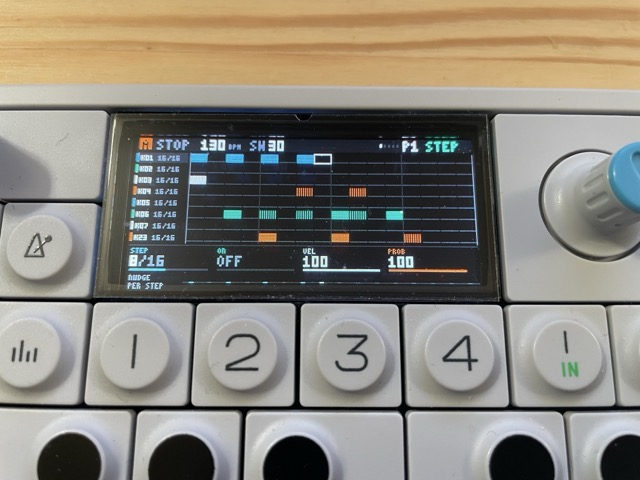
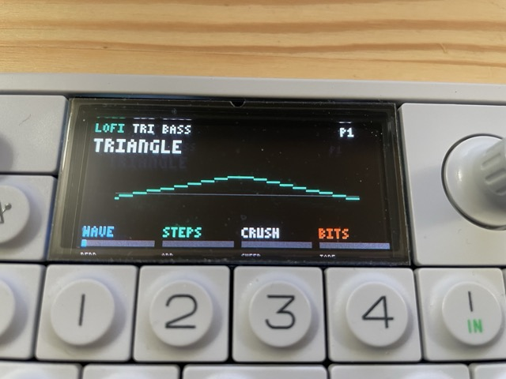
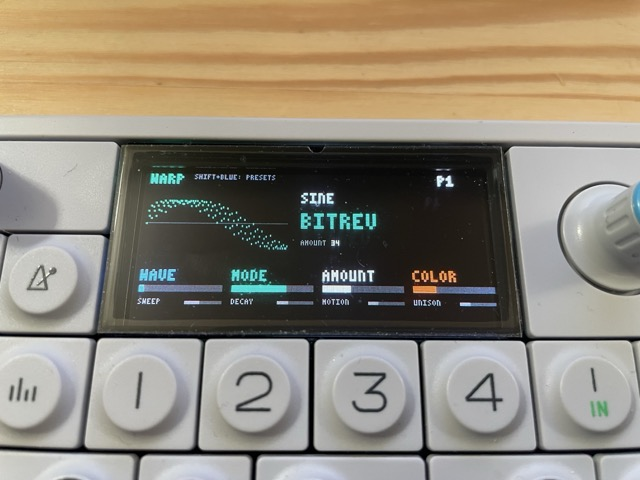
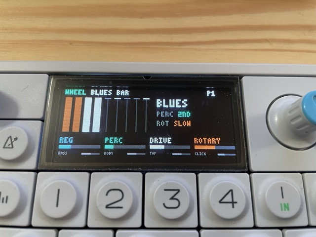

# op1-sdk

**Build anything on your OP-1.** New synth engines, effects, step sequencers, chord keyboards,
quantizers, screen overlays — whatever you can imagine, in C or assembly. Test it in a simulator,
then flash it to your Teenage Engineering OP-1 (firmware R246) in minutes.

Everything here runs on real hardware: the build pipeline is verified byte for byte, and the
features below have been flashed and played on a real OP-1.

## First: check out what's already built

One image ("op1plus"), composed from the feature library — build it, flash it, have fun.

**Synth engines** — new rows in TE's engine list, each with its own bank of sounds
(**shift + blue turn**), knob push flips pages:

| | |
|---|---|
| **LOFI** | chiptune waves + 16 pitch-tracking bytebeat formulas |
| **WHEEL** | tonewheel organ: registrations, percussion, click, drive, rotary speaker |
| **WARP** | 8 waves x 16 phase/output warps, sweep, motion, unison, colour |
| **TRIO** | SID-style 3 oscillators (ring/sync/AND) into an SVF filter, drive, noise |
| **engine_plus** | DRIVE / FILTER / RESO / CRUSH parameters for TE's own engines (fm, digital, string, cluster, phase, dna, voltage, iter) |

**Effects** — new rows in TE's FX list (synth, drum and master):

| | |
|---|---|
| **RESO** | resonator: four strings tuned to the notes you play |
| **SHIMMER** | reverb whose tail rises an interval per pass |
| **FX MIX** | seven effects in one slot: phaser, flanger, fold, fuzz, DJ filter, transient, texture |

**Performance features:**

| | open with | |
|---|---|---|
| **DRUM ROLL** | drum engine list / shift + green on the drum screen | FL-style step sequencer: 8 lanes, per-sample length, rate and filter, swing, ratchets, tape sync, 4 patterns kept across restarts |
| **REQUANTIZE** | shift + blue knob press (tape screen) | fix a recorded take on a piano roll: single notes or the whole take, grids to 1/32T |
| **CHORD+** | shift + insert | chord keyboard: white keys play scale chords, held black keys modify |

Controls and internals per feature: `features/<name>/README.md`. Full catalog:
[`docs/features.md`](docs/features.md), or `python3 tools/features.py list`.

## Image samples

Photographed on a real OP-1:

<table>
  <tr>
    <td><br><b>DRUM ROLL</b>: 8 lanes, per-step velocity and probability</td>
    <td><br><b>LOFI</b>: preset TRI BASS, stepped triangle</td>
  </tr>
  <tr>
    <td><br><b>WARP</b>: sine through the BITREV warp</td>
    <td><br><b>WHEEL</b>: preset BLUES BAR, drawbars and rotary</td>
  </tr>
</table>

## Get it on your OP-1

You need an original OP-1, a Mac, and your own copy of the official firmware file `op1_246.op1`
(R246, from Teenage Engineering's support page). The tools verify its SHA-256
(`c5315218…13a9`) and refuse to work on anything else. One-time setup: `./setup_toolchain.sh` builds the
[toolchain](docs/toolchain.md).

```sh
# 1. compose the op1plus image from your copy of the firmware
python3 tools/compose.py recipes/op1plus.json /path/to/op1_246.op1

# 2. OP-1 off → hold COM while switching on → choose "Firmware Upload", then:
python3 tools/flash.py build/apps/op1plus/build/op1plus.op1 --eject
```

The OP-1 shows `Found firmware package...` → `Done!` Restart and play.

Changed your mind? Flash your original `op1_246.op1` the same way and you are back to stock —
te-boot (the bootloader) is never touched, so restoring always works.

## Build your own — pair it with an AI coding model

This SDK is designed to be used together with a state-of-the-art AI coding model. That
combination lets you build practically anything you like, even without knowing Blackfin
assembly or the OP-1's internals: describe the synth or effect you want, point your agent at
this repo, and let it iterate until the tests pass — then flash and listen.

Why it works well with agents:

- every OP-1 address the SDK uses is declared with its signature and evidence in
  `include/op1/te246.h`
- every feature is a self-contained folder: manifest, sources, tests, simulator bench
- `python3 tools/test_all.py` verifies everything **without hardware** — the agent's feedback loop
- nothing is guessed: firmware hash checks, original-instruction checks, hook-collision checks

That is exactly how everything above was built.

Start your own feature:

```sh
python3 tools/features.py new my_feature --prefix mf_ --author "Your Name"
```

Learn from `examples/` (smallest first: `hello`, `counter_c`, `midi_events`); hook points for
keys, knobs, MIDI, note flow, display frame and sequencer tick: [`docs/features.md`](docs/features.md).

## Share it

- **As a .zip** — `python3 tools/features.py pack my_feature`; anyone installs it with
  `features.py install my_feature.zip` ([`docs/feature-package.md`](docs/feature-package.md))
- **To this repo** — a pull request adding `features/my_feature/`
  ([`CONTRIBUTING.md`](CONTRIBUTING.md))

## Thanks

This SDK stands on the shoulders of other people's work — thank you all:

| | |
|---|---|
| [op1r](https://github.com/pcppcp/op1r) | the R246 mod that proved custom code runs on the OP-1; our build pipeline reproduces its image byte for byte, and its hook technique and free memory region showed the way |
| [op1repacker](https://github.com/op1hacks/op1repacker) | unpacking and repacking `.op1` firmware files (our `op1pack.py` matches its LZMA settings) |
| [JIANT](https://github.com/juanjiant-bit/JIANT) | ideas behind LOFI, WHEEL, RESO and SHIMMER |
| [sloop-fm1](https://github.com/isod89/sloop-fm1) | ideas behind CHORD+, TRIO and parts of FX MIX |
| [strudel](https://codeberg.org/uzu/strudel) | ideas behind WARP and parts of FX MIX |
| [GNU binutils, GCC, GDB](https://www.gnu.org/software/) | the bfin-elf toolchain and the Blackfin simulator every test runs on |

Ideas only — all code here is our own (see [`docs/ideas.md`](docs/ideas.md) for sources and licenses).
And thanks to Teenage Engineering for building the OP-1.

## The fine print

- The OP-1's firmware is proprietary, so this repo contains **none of it** — you patch your own
  copy. Images you build contain TE's firmware: they are for your own device, don't redistribute
  `.op1`/`.ldr` files.
- MIT licensed ([`LICENSE`](LICENSE)). Not affiliated with or endorsed by Teenage Engineering.
- Flashing always carries a small risk; restoring stock works by re-flashing `op1_246.op1`.

## Dig deeper

| | |
|---|---|
| [`docs/toolchain.md`](docs/toolchain.md) | build the bfin-elf toolchain (binutils, GCC, GDB + simulator) |
| [`docs/features.md`](docs/features.md) | feature library, manifests, shared hook points |
| [`docs/feature-package.md`](docs/feature-package.md) | the packaging standard for sharing features |
| [`docs/internals.md`](docs/internals.md) | under the hood: R246 reverse-engineering notes, flashing internals, simulator benches |
| [`CONTRIBUTING.md`](CONTRIBUTING.md) | pull-request rules |
