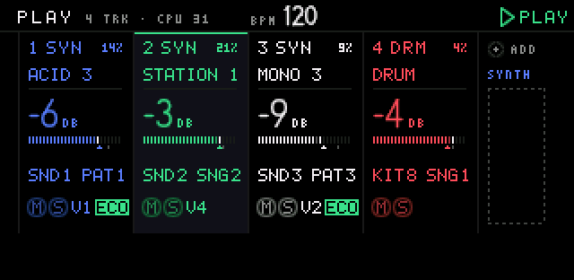
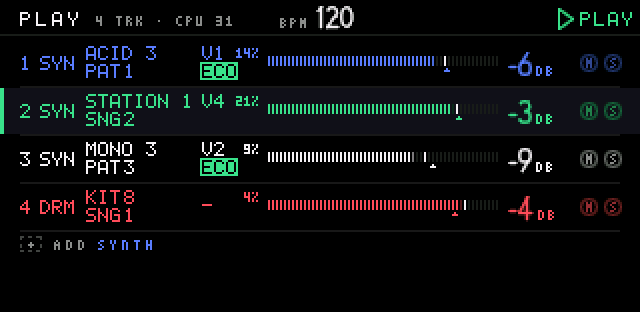
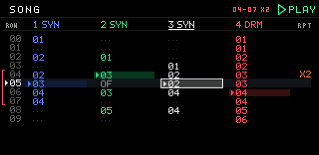
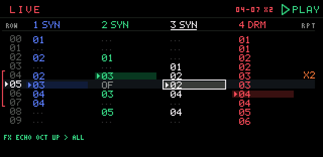
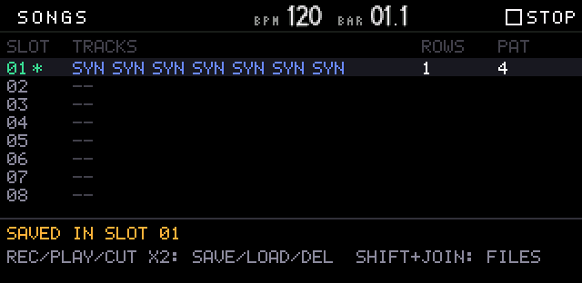
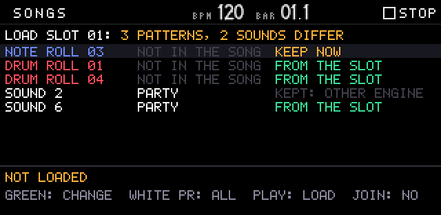
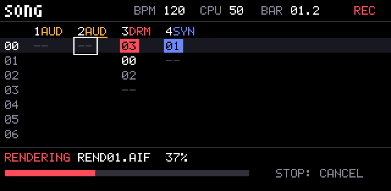
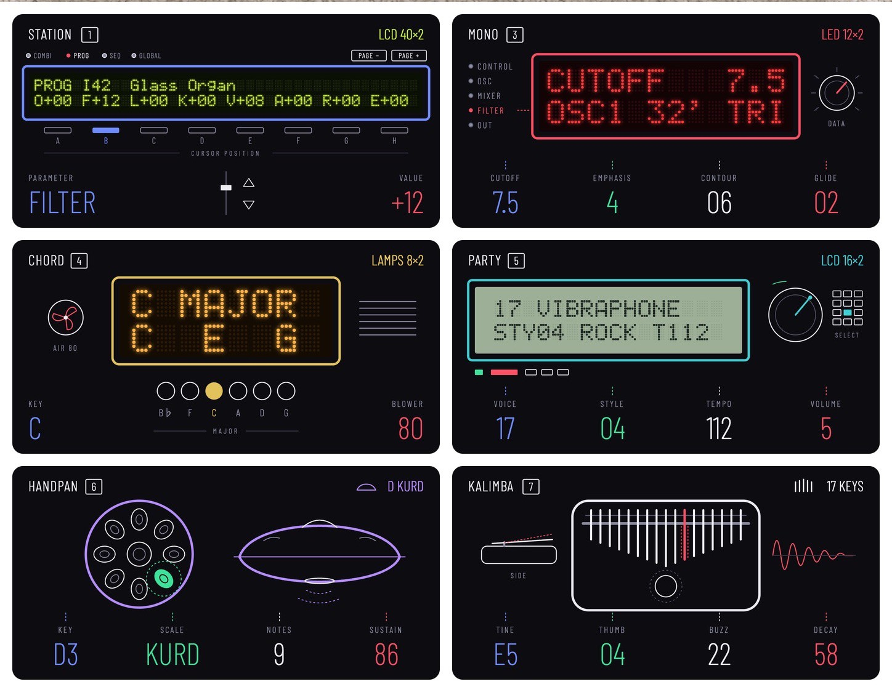

# op1-sdk

**Build anything on your OP-1.** New synth engines, effects, step sequencers, chord keyboards,
quantizers, screen overlays — whatever you can imagine, in C or assembly. Test it in a simulator,
then flash it to your Teenage Engineering OP-1 (firmware R246) in minutes.

Everything here runs on real hardware: the build pipeline is verified byte for byte, and the
features below have been flashed and played on a real OP-1.

**New: [PLAY](#new-play--songs-you-can-still-change)** — a tape screen that keeps your whole song
as notes and sound settings instead of audio: tweak it any time, share it as a small editable file.

## See it

**PLAY**, the new tape screen: the track list in two layouts (tape switches), the tracker, live
mode with trigger effects, song slots and render. Drawn by the real feature code (host preview /
simulator bench).

<table>
<tr>
<td><br><sub><b>Track list, LANES</b> (tape): one lane per track, live meters, M / S, voices, ECO</sub></td>
<td><br><sub><b>Track list, ROWS</b> (tape again): the same tracks as rows, wide meters</sub></td>
</tr>
<tr>
<td><br><sub><b>Tracker</b> (join): one column per track, each with its own playhead, a loop section</sub></td>
<td><br><sub><b>Live mode</b> (shift + rec): cue rows, hold black keys for trigger effects</sub></td>
</tr>
<tr>
<td><br><sub><b>Song slots</b> (shift + join): save / load / delete a whole song with its patterns and sounds</sub></td>
<td><br><sub><b>Loading asks</b>: per pattern and per sound, keep yours or take the slot's</sub></td>
</tr>
<tr>
<td><br><sub><b>Render</b> (rec): the song into an AIFF, when you want audio</sub></td>
<td></td>
</tr>
</table>

**Synth engine displays**: STATION 1, MONO 3, CHORD+, PARTY, HANDPAN and KALIMBA, drawn by the real
feature code in the simulator benches (`python3 tools/test_all.py` writes them to `build/demo/`):



## First: check out what's already built

One image ("op1plus"), composed from the feature library — build it, flash it, have fun.

**Synth engines** — ten new rows in TE's engine list with **168 ready-to-play sounds** between
them (plus PSS-11's built-in 8, or 39 with a ROM library), each engine with its own bank
(**shift + blue turn**), knob push flips pages:

| | sounds | |
|---|---|---|
| **LOFI** | 14 | chiptune waves + 16 pitch-tracking bytebeat formulas |
| **MALLET** | 16 | struck instruments by modal synthesis: marimba, vibraphone (with motor), xylophone, glockenspiel, steelpan, handpan, kalimba, tubular bells |
| **WHEEL** | 24 | tonewheel organ: registrations, percussion, click, drive, rotary speaker |
| **WARP** | 16 | 8 waves x 16 phase/output warps, sweep, motion, unison, colour |
| **TRIO** | 16 | SID-style 3 oscillators (ring/sync/AND) into an SVF filter, drive, noise |
| **MONO 3** | 16 | classic 70s-style mono synth, played with 4 voices: 3 band-limited oscillators (range / wave / level), noise, a 4-pole ladder filter that self-oscillates in tune, filter and loudness contours, glide — fat basses, leads, brass, pads |
| **PARTY** | 8 | Yamaha PSS-11 AWM tone generator (GEW7) recreated after MAME: 8/12-bit samples, chip envelope and LFO, two layers, filter, bank. No Yamaha sounds included: 8 own waves until you build the library from your own ROM dump with `gen_pss11.py --pss-rom` |
| **ACID 3** | 16 | TD-3-MO-style bassline (303 type with the "modded out" mods), monophonic: saw / square + sub, overdrive into a resonant 4-pole filter, normal and accent decay, accent sweep that stacks up, slide on legato keys (10 .. 360 ms), soft attack, filter tracking, filter FM, muffler; accents from MIDI velocity, every note or every 2nd / 3rd / 4th |
| **PALETTE** | 22 | JD-08-style layered digital synth: up to four tones per patch, each with its own wave (24 band-limited own waves), pitch envelope, filter (LPF 24 dB / BPF / HPF) with envelope, amp envelope and two LFOs; the four knobs are the palette: one page per parameter row (level, wave, pitch, cutoff, envelope time), one knob per tone. No Roland waves or patches included |
| **STATION 1** | 28 | late-80s-style sample workstation: **100 sampled multisounds** (pianos, organs, strings, choir, brass, bells, basses, waves), two layered per sound, B transposed / fading in, low-pass with envelope; a sound library included (+ two drum kits for the drum sampler) |
| **engine_plus** | | DRIVE / FILTER / RESO / CRUSH parameters for TE's own engines (fm, digital, string, cluster, phase, dna, voltage, iter) |

**Sound quality first**: the engines render at the OP-1's internal 88.2 kHz; MONO 3's
oscillators are band-limited (no aliasing whine on high notes) and its filter stays stable at every
setting; STATION 1 plays a sound library at 31.25 kHz, with its key splits
and tuning. Their simulator tests sweep every
parameter through its full range, so each knob moves its sound one way, as the screen says.
They are light, too: measured on the device, an SDK engine takes 10-19 % of the CPU while
playing, about what TE's light engines cost (voices that went silent are not rendered).

**Effects** — new rows in TE's FX list (synth, drum and master):

| | |
|---|---|
| **RESO** | resonator: four strings tuned to the notes you play |
| **SHIMMER** | reverb whose tail rises an interval per pass |
| **FX MIX** | fifteen effects in one slot: phaser, flanger, chorus, comb, ring mod, tremolo, fold, fuzz, bitcrush, DJ filter, ladder, auto-wah, vowel, transient, texture |

**Performance features:**

| | open with | |
|---|---|---|
| **DRUM ROLL** | shift + blue knob press on the finger sequencer screen (drums) | step editor for TE's finger sequencer: each of the 14 finger patterns as 8 lanes with per-sample length, rate and filter, per-step velocity, probability, ratchets; swing; the finger keys play it; kept across restarts; black keys = punch-in effects (fill, random, echo, retrig, retrig fast, oct up / down, coin, solo lead / bass: the order of PLAY's live mode) |
| **NOTE ROLL** | shift + blue knob press on the finger sequencer screen (synth) | step editor for TE's synth finger sequencer, DRUM ROLL's twin: chords up to 6 notes, per-note velocity and length (ties), nudge, probability, ratchets, patterns up to 64 steps; the finger keys play it; black keys = punch-in effects (fill, random, echo, retrig, retrig fast, oct up / down, coin, solo lead / bass: the order of PLAY's live mode); kept across restarts |
| **SYNTH ROLL** (requantize) | shift + blue knob press (tape screen) | fix a recorded take on a piano roll in DRUM ROLL's look: by default every note snaps clean to the grid (start and length), single notes or the whole take, grids to 1/32T |
| **CHORD+** | shift + insert | chord keyboard: white keys play scale chords, held black keys modify (lower octave: min/maj, 7th, sus4, 9th, inversion; upper: power, sus2, open / wide voicing, more inversion) |

**Leaner firmware** — room (flash, code, CPU) for everything above:

| | |
|---|---|
| **drumtrim** | TE's 14 factory drum kits without their silent tails: −1.43 MB of flash, every hit bit-identical up to the cut (made from your own firmware file, nothing of TE's is committed) |
| **slotlink** | six default slot sounds that are byte-identical copies of factory sounds leave the update and are recreated from the factory files when TE fills the slots: update 2.1 MB smaller |
| **nophysics** | TE's Box2D physics library out, with its only users, the Tombola sequencer (picking it gives pattern) and the hidden Lander game: no physics worlds built at boot, 145 KB of code freed for SDK code; a static reachability proof (`prove.py`) shows nothing else can reach it |
| **nodsynth** | dsynth (TE's most CPU-hungry engine, about 50 % on its own) leaves the engine list and preset browser; its code stays, so sounds saved with it still play |

## New: PLAY — songs you can still change

On a stock OP-1 a song ends up on the tape as audio: once a part is recorded, its notes and its
sound are baked in. **PLAY** keeps the whole song **as parameters** instead: the notes (NOTE ROLL /
DRUM ROLL patterns), the arrangement, and every synth sound (engine, knob values, envelope, octave).
So nothing is ever final:

- **Tweak anything, any time** — change a note in bar 37, swap the bass sound, turn a filter
  knob, re-arrange the chorus: the whole song plays the change at once. No re-recording.
- **Optimize** — try another engine on a part, thin out a pattern, move a section; compare by
  loading slots back and forth.
- **Share it editable** — a song slot is one small `.PSL` file (~8 KB for a small song, ~84 KB
  with all 28 patterns used; a minute of stereo audio is ~10 MB). Whoever loads it gets every
  note and every sound, not a mixdown: remix it, fix it, send it back.
- **Audio only when you want it** — **rec** renders the song into an AIFF in one go, for the
  computer or as one cheap AUDIO track.

Screens: [See it](#see-it) at the top.

**How it plays:** the tape key opens a list of up to **8 tracks**, all sample-locked from bar 1,
with level, mute, solo and master. Play and stop drive PLAY from every screen (album excepted), and the tempo is TE's tempo page, followed live:

- **SYNTH** — NOTE ROLL patterns on any synth engine: TE's own (FM, digital, string, cluster,
  pulse, sampler, phase, dna, dsynth, voltage, iter) or the SDK's (ACID 3, MONO 3, STATION 1,
  PARTY, PALETTE, MALLET, WHEEL, WARP, TRIO), each track on its own instance, so two tracks can
  play two FM sounds at once; up to 6 sound at once, the 4th to 6th while the CPU allows;
- **DRUM** — DRUM ROLL patterns on TE's drum kits;
- **AUDIO** — a WAV / AIFF from disk mode's `play/` folder, looped or once, streamed from flash.

A **tracker song** arranges the tracks: 128 rows x one column per track, chains of pattern +
transpose, live mode. **16 song slots** keep songs on the OP-1. Disk mode shows the slots as
`.PSL` files and the renders as AIFF, and `.PSL` files you put there land in free slots. Drum
kits and audio files are named, not stored, so share them alongside. The mix joins TE's master bus
like the tape does.

**Four demo songs** come in the image (slots 13-16 at the first boot, or copy
[`features/play/demos/*.PSL`](features/play/demos) into `play_s/`): WAREHOUSE (techno, 303 line),
PIANO HOUSE (M1 piano and organ bass), RADIO (pop, I V vi IV) and PRELUDE (Bach's Prelude in C,
BWV 846). Load the m1 drums kit into drum slot 8 first; details in the
[PLAY README](features/play/README.md#demo-songs).

PLAY replaces TE's tape screen in its image (`recipes/op1play.json`, op1plus + PLAY); TE's tape
data is never touched. Status: **experimental**, on-device tests ongoing. Controls and details:
[`features/play/README.md`](features/play/README.md).

## More recipes

Variants of op1plus; for the debug ones, flash op1plus again when done:

| recipe | |
|---|---|
| `recipes/op1play.json` | op1plus + **PLAY** tape screen (above) + its debug probe |
| `recipes/op1cpu.json` | op1plus + **cpuinfo** (debug): shift + speech shows the audio CPU load measured on the device, and our engines' share of it |
| `recipes/op1disk.json` | **noalbum** (album sides cut to 1 s, ~128 MB more free flash) and the **diskinfo** flash usage panel, on an older op1plus feature set |
| `recipes/op1mem.json` | **meminfo** SDRAM panel (debug), on an older op1plus feature set |

Controls and internals per feature: `features/<name>/README.md`. Full catalog:
[`docs/features.md`](docs/features.md), or `python3 tools/features.py list`.

## Get it on your OP-1

You need an original OP-1, a Mac, and your own copy of the official firmware file `op1_246.op1`
(R246, from Teenage Engineering's support page). The tools verify its SHA-256
(`c5315218…13a9`) and refuse to work on anything else. One-time setup: `./setup_toolchain.sh` builds the
[toolchain](docs/toolchain.md).

```sh
# 1. compose the op1plus image from your copy of the firmware
python3 tools/compose.py recipes/op1plus.json /path/to/op1_246.op1

# 2. OP-1 off → hold COM while switching on → choose "Firmware Upload", then:
python3 tools/flash.py build/apps/op1plus/build/op1plus.op1 --eject
```

The OP-1 shows `Found firmware package...` → `Done!` Restart and play.

Changed your mind? Flash your original `op1_246.op1` the same way and you are back to stock —
te-boot (the bootloader) is never touched, so restoring always works.

## Build your own — pair it with an AI coding model

This SDK is designed to be used together with a state-of-the-art AI coding model. That
combination lets you build practically anything you like, even without knowing Blackfin
assembly or the OP-1's internals: describe the synth or effect you want, point your agent at
this repo, and let it iterate until the tests pass — then flash and listen.

Why it works well with agents:

- every OP-1 address the SDK uses is declared with its signature and evidence in
  `include/op1/te246.h`
- every feature is a self-contained folder: manifest, sources, tests, simulator bench
- `python3 tools/test_all.py` verifies everything **without hardware** — the agent's feedback loop
- nothing is guessed: firmware hash checks, original-instruction checks, hook-collision checks

That is exactly how everything above was built.

Start your own feature:

```sh
python3 tools/features.py new my_feature --prefix mf_ --author "Your Name"
```

Learn from `examples/` (smallest first: `hello`, `counter_c`, `midi_events`); hook points for
keys, knobs, MIDI, note flow, display frame and sequencer tick: [`docs/features.md`](docs/features.md).

## Share it

- **As a .zip** — `python3 tools/features.py pack my_feature`; anyone installs it with
  `features.py install my_feature.zip` ([`docs/feature-package.md`](docs/feature-package.md))
- **To this repo** — a pull request adding `features/my_feature/`
  ([`CONTRIBUTING.md`](CONTRIBUTING.md))

## Thanks

This SDK stands on the shoulders of other people's work — thank you all:

| | |
|---|---|
| [op1r](https://github.com/pcppcp/op1r) | the R246 mod that proved custom code runs on the OP-1; our build pipeline reproduces its image byte for byte, and its hook technique and free memory region showed the way |
| [op1repacker](https://github.com/op1hacks/op1repacker) | unpacking and repacking `.op1` firmware files (our `op1pack.py` matches its LZMA settings) |
| [JIANT](https://github.com/juanjiant-bit/JIANT) | ideas behind LOFI, WHEEL, RESO and SHIMMER |
| [sloop-fm1](https://github.com/isod89/sloop-fm1) | ideas behind CHORD+, TRIO and parts of FX MIX |
| [strudel](https://codeberg.org/uzu/strudel) | ideas behind WARP and parts of FX MIX |
| [GNU binutils, GCC, GDB](https://www.gnu.org/software/) | the bfin-elf toolchain and the Blackfin simulator every test runs on |

Ideas only — all code here is our own (see [`docs/ideas.md`](docs/ideas.md) for sources and licenses).
And thanks to Teenage Engineering for building the OP-1.

## The fine print

- The OP-1's firmware is proprietary, so this repo contains **none of it** — you patch your own
  copy. Images you build contain TE's firmware: they are for your own device, don't redistribute
  `.op1`/`.ldr` files.
- MIT licensed ([`LICENSE`](LICENSE)), except the PARTY AWM model (BSD-3-Clause parts after MAME, `features/party/NOTICE`) and the sound libraries in `features/m1/build/` and `features/party/build/`
  (M1 multisounds, not ours: [`NOTICE`](features/m1/build/NOTICE)). Not affiliated with or endorsed by Teenage Engineering.
- Flashing always carries a small risk; restoring stock works by re-flashing `op1_246.op1`.

## Dig deeper

| | |
|---|---|
| [`docs/toolchain.md`](docs/toolchain.md) | build the bfin-elf toolchain (binutils, GCC, GDB + simulator) |
| [`docs/lessons.md`](docs/lessons.md) | lessons learned per dev day: TE internals found, DSP techniques, how we work |
| [`docs/features.md`](docs/features.md) | feature library, manifests, shared hook points |
| [`docs/feature-package.md`](docs/feature-package.md) | the packaging standard for sharing features |
| [`docs/internals.md`](docs/internals.md) | under the hood: R246 reverse-engineering notes, flashing internals, simulator benches |
| [`docs/performance.md`](docs/performance.md) | CPU measured on the device: clock, audio load per engine, where the cycles go |
| [`CONTRIBUTING.md`](CONTRIBUTING.md) | pull-request rules |
